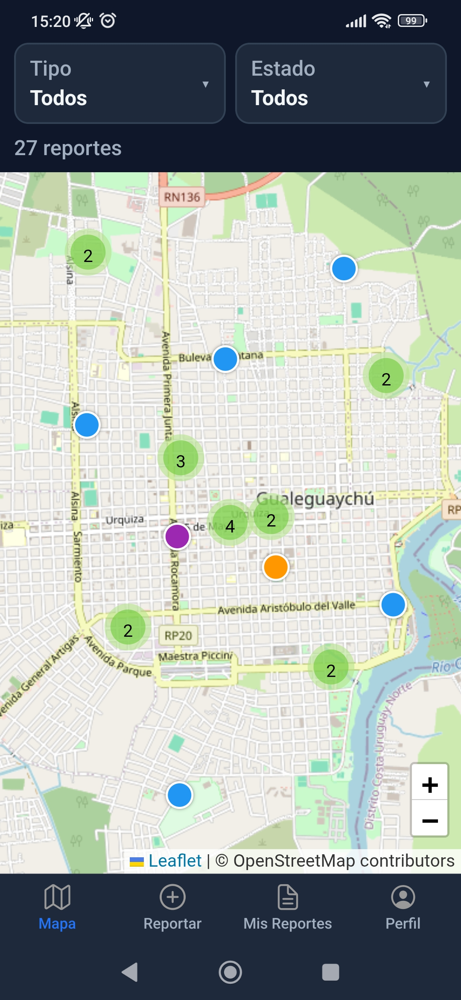
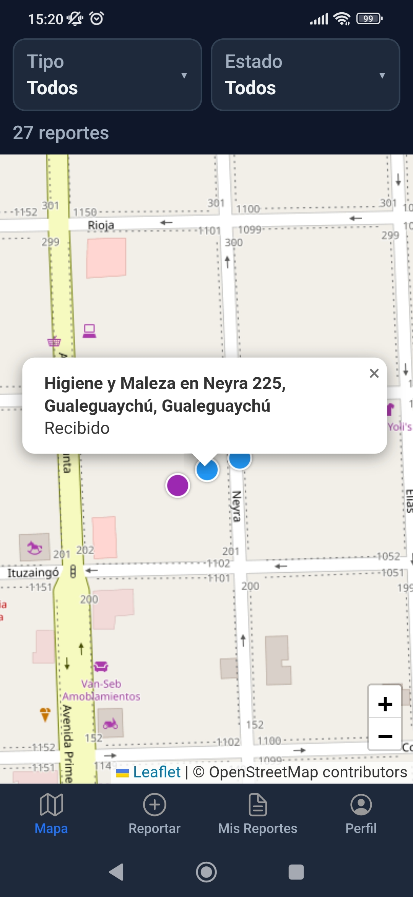
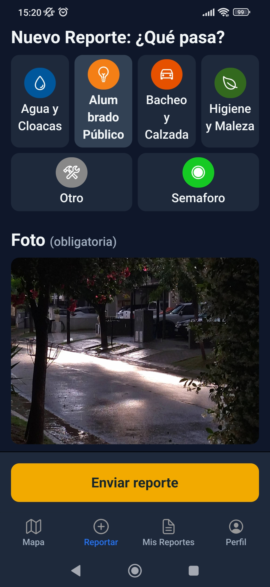
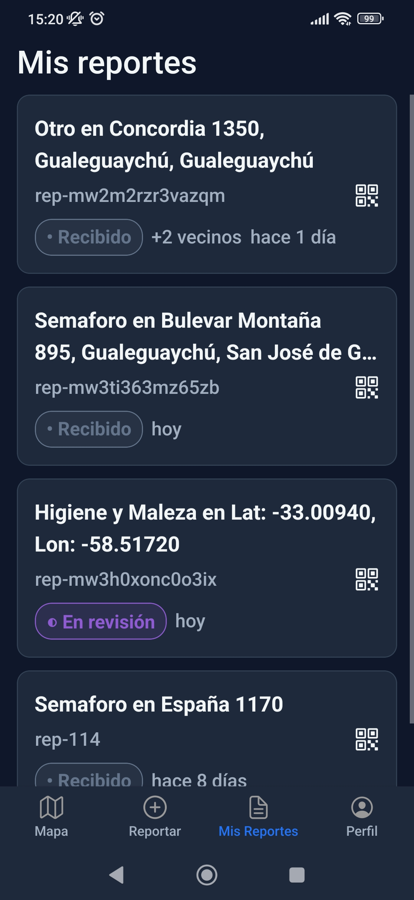

# UNER — Desarrollo para móviles 2026 (Grupo 3)

Repositorio de trabajos prácticos de la cátedra **Desarrollo para móviles** — Tecnicatura Universitaria en Desarrollo Web (Facultad de Ciencias de la Administración, UNER).

---

## 👥 Integrantes

| Integrante             |
| :--------------------- |
| **Aguilera**, Mailin   |
| **Belardita**, Horacio |
| **Beron**, Tomás       |
| **Fernandez**, Mateo   |
| **Ortega**, Sergio     |
| **Sandoval**, Edgardo  |

---

## 🚀 Trabajo Final Integrador

### PRD - Reporte Ciudadano

